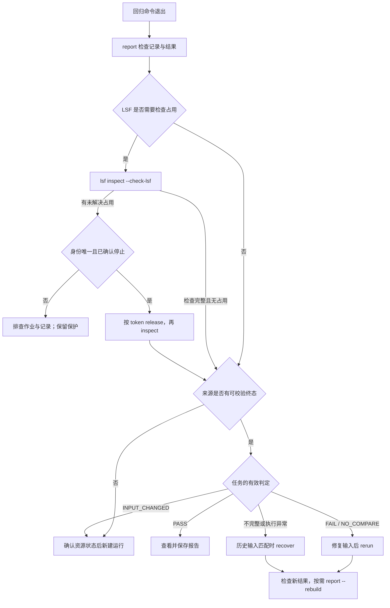

# 回归结束后的 inspect、release、rerun、recover 流程

本文以一次 `nsim regr` 的收尾为主线。`inspect` 和 `release` 的完整命令是
`nsim lsf inspect`、`nsim lsf release`；`rerun`、`recover` 是顶层命令。
它们不是每次回归都必须依次执行的四个步骤：先确认结果与作业占用，再按失败类型
选择后续动作。正常完成且通过的回归，查看报告即可；local 执行无需 LSF 占用处理。
下文的编译流程以包含 `compile` 步骤的 command submit 为例。

## 1. 先确认“结束”是哪一种状态

终端命令退出、LSF job 结束、回归形成可信完成记录、case 通过，是不同的状态。

| 观察到的情况 | 能说明什么 | 下一步 |
| --- | --- | --- |
| `report` 返回完整 PASS | 完成记录和通过证据可校验 | 查看、保存报告，无需重跑或释放 |
| `report` 返回完整 FAIL | 回归已有可信终态，但存在失败任务 | 按 `effective_verdict` 选择 rerun 或 recover |
| `report` 提示不完整 | 展示文件、case 证据或控制记录有问题 | 用 `--json` 看原因，区分后再处理 |
| 命令退出，但有 `LSF_UNKNOWN`、取消未确认或提交 ID 丢失 | 远端 job 可能仍活动 | inspect；确认身份和停止状态后才 release |
| 没有有效 `final.json`，或计划/状态校验失败 | 不能作为可信的整轮重跑来源 | 处理占用和记录问题；必要时新建回归 |

回归的完成标志是 `report/final.json` 及其绑定的控制记录通过校验，而非单看文件
存在。回归 case 的 `run.json` 引用公共记录；传入单个 case 目录也不能绕过公共
回归终态校验。真正的单跑使用 `run.json` 内的 `terminal` 和完整性校验。

后文路径、submit、清单与 token 均需替换为实际值。先保存本轮路径：

```sh
REGR=/data/output/regr_dir/本轮回归目录
nsim report "$REGR"
nsim report "$REGR" --json
```

`SOURCE` 通常可使用回归根或运行返回的 `record_dir`（回归的 `report/`）。
使用 `regr -rl` 时，先从批次报告选中一轮具体回归；不要把
`regr_batch_dir/<批次>` 总目录交给 inspect、release、rerun 或 recover。

## 2. 四个命令的分工与整体流程

| 命令 | 解决的问题 | 是否提交新作业 | 对历史记录的影响 |
| --- | --- | --- | --- |
| `nsim lsf inspect SOURCE` | 查明 job 占用及记录是否完整 | 否；`--check-lsf` 只增加查询 | 只读，不更新保存状态或解除占用 |
| `nsim lsf release SOURCE --token TOKEN` | 解除一个已确认停止 job 的遗留占用 | 否，也不取消 job | 写释放凭据，移除该 token 的保护；原结果不变 |
| `nsim rerun SOURCE` | 使用当前修复后的输入验证完整执行但结果失败的任务 | 是，独立编译、仿真、检查 | 新建执行目录，原结果保留 |
| `nsim recover SOURCE` | 用可验证的历史输入重做未形成完整有效结果的任务 | 是，独立编译、仿真、检查 | 新建执行目录，原结果保留 |

`report --rebuild` 是独立动作：根据已有证据生成汇总报告，不执行仿真，不释放
占用，也不补写原回归的完成记录。



## 3. inspect：先看占用，再看实时集群状态

```sh
# 只读本地记录；默认只列未解决占用和异常记录
nsim lsf inspect "$REGR"

# 增加集群查询；JSON 可看到 releasable 等字段
nsim lsf inspect "$REGR" --check-lsf --json

# 缩小到一个 case 或共享编译目录；base/rtl 按实际 submit/workspace 修改
nsim lsf inspect "$REGR/base/rtl/sim_dir/smoke_42" --check-lsf
nsim lsf inspect "$REGR/base/rtl/com_dir" --check-lsf
```

回归检查根据计划确定范围，检查编译目录与已创建的 case；编译目录还会列出使用
该产物的仿真读者。`SOURCE` 不是任意输出根的递归扫描入口。

| 字段/输出 | 读法 |
| --- | --- |
| `token` | 完整 32 位十六进制提交标识；release 使用它，不是 job ID |
| `job_id` | LSF 分配的编号；提交回执丢失时可能为空 |
| `saved_status` / `saved` | 当时保存的状态，不代表当前集群状态 |
| `checked.status` / `checked` | 本次 `--check-lsf` 的查询结果；未加选项则未查询 |
| `checked.releasable` | 本次是否确认身份及 job/后处理停止；release 仍会重新查询 |
| `protected_paths`、`markers` | 受保护的 case/编译路径及当前保护标记 |
| `issues`、`missing_markers` | 缺失、损坏、冲突或查询问题，需逐项调查 |
| `uncreated_cases` | 尚未派发、因此未创建目录的 case，不等于目录损坏 |
| `complete` | 检查范围是否完整，不表示 case 通过或没有占用 |

**inspect 返回 0 时仍可能列出未解决 job。** 必须看 jobs、问题项与当前状态，
不能仅凭退出码覆盖输出。`--check-lsf` 不会把保存的 UNKNOWN 写成 DONE，
也不会自动 release。

## 4. release：按 token 解除已停止 job 的遗留占用

只有 inspect 发现需要处理的占用时才考虑 release。正常完成的作业通常已经清理
保护记录，无需逐个 release。

```sh
# 将 TOKEN 换成 inspect 返回的完整 token；每次只处理一个
nsim lsf release "$REGR" --token TOKEN --json

# 检查是否仍有其他 job、编译读者或异常记录
nsim lsf inspect "$REGR" --check-lsf --json
```

release 会重新读取记录、取得产品锁、核对当前用户的输出所有权，并实时查询 LSF。
除数字 ID 外，还核对完整 job name、用户、输出路径及已观察到的提交时间。
ID 丢失时可按完整 job name 查找，但必须得到唯一且身份匹配的记录。

PEND/RUN/暂停、未知状态、查不到记录、身份冲突、记录损坏或控制器仍持锁，都会
拒绝释放。查不到 job 不能证明已停止。当前不自动查询 `bhist/bacct`；超出
`bjobs` 保留范围时需要进一步调查。新提交记录包含后处理等待约定；旧记录缺少
该约定时，单纯 DONE/EXIT 还不足以释放，需要明确后处理终态。状态细节见
[LSF 执行](lsf_execution.md)。

成功后，在对应 job 的工作目录写 `.lsf-release-<token>.json`，绑定原记录摘要
与本次查询证据，仅移除该 token 的旧标记/编译读者记录。其他 job 的保护不变。
原 `run.json`、`job.json`、回归状态与 case 结论不改；重复成功释放是幂等操作。
没有 `--force`；不要手工删除读者标记、锁文件或运行记录来绕过占用检查。

**release 不会补出 `final.json`。** 例如唯一并发名额被未知 job 占用，后续 case
未派发，整轮未发布完成记录；后来 job 停止且 release 成功，只说明占用解除。
此时仍不能直接 rerun/recover 这轮回归，应新建回归。release 不会补齐日志、
继续剩余 case，或把原结论改成 PASS。

## 5. 按有效判定选择 rerun 或 recover

两者先校验来源终态记录，再选择任务；不会跨所有历史重跑目录自动汇总“现在还
失败的任务”。按 `report SOURCE --json` 的 `effective_verdict` 选择操作。

| 来源任务的有效判定 | 选择 | 输入条件/注意事项 |
| --- | --- | --- |
| `PASS`、`PASS_LIVE` | 无需重跑 | 通过证据损坏后可能重新评为 INCOMPLETE |
| `FAIL`、`NO_COMPARE` | rerun | 固定原 submit/case/seed，读取当前输入 |
| `INCOMPLETE`、`CRASH`、`TIMEOUT` | recover | 控制记录有效，历史输入与运行时仍匹配 |
| `COMPILE_FAIL`、`HOOK_FAIL`、`INFRA_ERROR`、已确认终态的调度错误/取消 | recover | 仅修复外部环境即可重试时适用；需改源码或 submit 则新建运行 |
| `INPUT_CHANGED` | 新建 run/regr | 两种 replay 都不选择它 |
| 状态未知且整轮无可信终态 | inspect，必要时 release；之后新建运行 | 不是 recover 的可用来源 |

rerun 只选 `FAIL/NO_COMPARE`；recover 排除
`PASS/PASS_LIVE/FAIL/NO_COMPARE/INPUT_CHANGED`，从其余任务中选择，因此不局限于
存储故障。两者无匹配任务时返回 `record_dir: null`、`no matching failed tasks`，
不创建目录。这不保证返回 0；原回归还有另一类失败时，`passed` 仍为 false。

### rerun：验证当前修复，固定失败组合

```sh
# 修改源码、testbench、数据或配置后，重跑本轮 FAIL/NO_COMPARE
nsim rerun "$REGR" --jobs 4 -dir rerun_fix_1
nsim report "$REGR/rerun_fix_1"

# 仅重跑一个符合条件的 case/seed
nsim rerun "$REGR/base/rtl/sim_dir/smoke_42" --jobs 1

# 仅选择上次 rerun 中仍符合条件的失败
nsim rerun "$REGR/rerun_fix_1" --jobs 4 -dir rerun_fix_2
```

submit/case/seed 保持精确组合。例如失败 A/42 与 B/43，只执行这两项，不产生
A/43 或 B/42。当前清单新增 case 不扩大选择；原失败 case 被删、submit 改名或
输入丢失则报错。重新读取当前工程登记、RTL/TB、原 submit 路径及父模板、case
配置与声明输入，保留原 CLI plusargs。

每个选中 submit 在新目录强制编译一次，再完整执行其 case；编译失败则不运行该
submit 的仿真。command submit 必须声明 compile。fake 只生成测试用准备记录，
不代表运行商业编译器。稳定启动器使用来源工程当前版本 pin，无 pin 时使用记录
版本；本次建立新输入 hash 和快照，并在运行前后检查一致性。

调度配置来自当前 submit，并发默认沿用来源，可用 `--jobs` 调整。rerun 不接受
seed、输出根、`--project`、`-sub`、`-l`、`-repeat`、队列或 `--dry-run` 覆盖。
需改变运行选择时新建 run/regr。更多规则见 [修复后的失败 case 重跑](rerun.md)。

### recover：在历史输入条件下重新执行

```sh
# 修复存储、集群或外部环境问题，保持历史输入不变
nsim recover "$REGR" --jobs 4 -dir recover_storage_1
nsim report "$REGR/recover_storage_1"

# 换用已准备好的输出根；原控制记录仍必须可读
nsim storage check /backup/output
nsim recover "$REGR" -o /backup/output --jobs 4 -dir recover_storage_2
```

recover 使用历史计划和运行时身份，检查声明输入的内容、文件集合、工具源码、
Python 和依赖等。稳定启动器选择记录版本，不会自动 checkout 旧源码、找回已删
文件或还原整套工程。schema 2 使用历史工程注册快照；后来修改默认输出目录不会
替代历史设置。

对上述 `regr` 来源，recover 在独立目录重新编译、仿真、检查，完整重做所选任务，
不是 checkpoint 续跑。并发默认沿用来源；默认使用历史输出根，可用 `-o` 换根。
无自动基础设施重试或输出根故障切换；兼容参数 `--retries`、`--retry-seconds`
必须为 0。recover 允许 `-seed/--seed` 指定一个新 seed，但该结果不能在原汇总中
替代原 seed；补齐原回归时通常保留原 seed。

recover 不接受当前 submit、case 清单或队列覆盖。修改源码、脚本、超时设置或
submit 后，历史校验会拒绝。例如修改编译脚本解决 `COMPILE_FAIL`，应新建
run/regr；rerun 也不会选择该判定。

**同一轮兼有逻辑失败和基础设施失败时，先在历史输入仍可验证时 recover，再改
输入并 rerun。** 已修改输入时，recover 不会自动改用当前输入。

## 6. 新结果与手动汇总

```text
<output-root>/regr_dir/<原回归目录>/
├── report/                         原计划、状态、报告、final.json
├── <submit>/<workspace>/           原编译与 case 产物
├── rerun_<时间_UUID>/               或 -dir 指定的名称
│   ├── report/                     本次独立记录和报告
│   └── <submit>/<workspace>/        本次编译与仿真产物
├── recover_<时间_UUID>/             本次独立记录和产物
└── report_<时间_UUID>/              手动综合报告
    ├── report.html
    ├── report.md
    ├── state.json
    └── summary.json                 汇总来源和替换任务来源
```

`-dir/--dir` 指定新执行目录名，不修改原工作区名。只接受单个名称，不能含路径
分隔符，也不能为 `.` 或 `..`；指定名称已存在时报错，不覆盖。不指定则生成唯一
名称。再次 rerun 某次重跑，新目录仍在原回归下与前次并列，parent 指向直接来源。
真正单跑来源没有回归根时，新目录在原 submit 工作区下。删除原回归/工作区会连同
其中 replay 结果一起删除。

rerun/recover 只报告本次选中的任务，成功也不把原回归或批次报告改成 PASS。
需要整体结论时，对**原回归**手动汇总：

```sh
nsim report "$REGR" --rebuild -dir report_review_1 --json

# 指定一次 rerun 和一次位于其他输出根的 recover
nsim report "$REGR" --rebuild -dir report_review_2 \
  --include "$REGR/rerun_fix_1" \
  --include /backup/output/regr_dir/本轮回归目录/recover_storage_2
```

默认只选择原回归下**完成时间最新的一次 rerun 和一次 recover**，再与原结果合并，
不是合并全部历史 replay。按可信 `ended_at` 判断最新；来源或时间不明确、时间
并列、目录不完整时要求显式选择。`--include` 每类最多指定一个目录；只指定一类
时，另一类仍自动选择。跨输出根结果须显式 include。

按来源任务 ID 与 submit/case/seed 匹配；两个所选 replay 都含某任务时，采用
完成时间较晚的结果。最新证据不完整时，不回退到更早 PASS。
**若先单独 rerun A，再单独 rerun B，默认汇总只选较晚的 B 那轮，A 不会自动
沿用较早重跑的 PASS。** 需要覆盖全部原失败任务时，可修复后从原回归再做一次
完整失败集 rerun，并以该轮作为汇总来源。

直接打开命令返回的 `rebuilt_report_path` 对应 HTML。新汇总目录没有 replay
所需的终态记录，不作为下一次 rerun/recover 的 SOURCE。重建不修改原报告或
`final.json`。仅展示文件损坏时可重建供查看，但原展示文件并未修复，原来源仍
可能被 replay 的严格校验拒绝；应恢复可验证的原文件或新建运行，不能用重建页面
替代原控制记录。更多目录与兼容规则见 [重跑、恢复与报告](replay_reports.md)。

## 7. 常见处理顺序与退出码

| 场景 | 处理顺序 |
| --- | --- |
| 正常 PASS | report → 保存报告 |
| 逻辑 FAIL/NO_COMPARE | report → 修改输入 → rerun → 检查新报告 → 按需 rebuild |
| 存储/执行异常且有可信终态 | report → 修复外部条件、保留输入 → recover → 检查新报告 → 按需 rebuild |
| LSF UNKNOWN 且整轮无终态 | inspect → 核对停止后逐 token release → inspect → 新建 regr |
| 只有展示文件损坏 | report --json → 控制记录有效时 rebuild，不为修页面执行 case |
| 计划、状态或完成记录损坏/缺失 | 排查占用与备份；无法恢复可信记录时新建运行，rebuild 不能补造终态 |
| INPUT_CHANGED | 固定输入后新建 run/regr |

新建回归示例（在已配置的验证工程内，显式保留要复现的 seed）：

```sh
nsim regr -sub rtl -l caselist/smoke.list -seed 42 --jobs 4 -o /data/output
```

这是新的回归身份和独立目录，不会接着执行旧队列。local 场景按工程配置或添加
`-scheduler local` 选择执行方式。

| 命令 | 返回 0 | 返回 1 | 返回 2 |
| --- | --- | --- | --- |
| `lsf inspect` | 检查范围完整，仍可能有占用 | — | 记录、标记、查询或参数等异常 |
| `lsf release` | 已释放或已成功释放过 | — | 身份/状态/记录/查询/锁等条件不满足 |
| `report` / `report --rebuild` | 报告完整且通过 | 报告完整但任务失败 | 报告/证据不完整或命令错误 |
| `rerun` / `recover` | 本次通过，或无匹配任务且来源通过 | 本次未通过，或无匹配任务且来源未通过 | 配置/身份/完整性错误或报告/调度错误 |

执行被 Ctrl-C 中断时返回 130；是否形成终态仍以保存的控制记录为准。自动化脚本
应结合结构化输出和返回码处理，不能把“没有匹配任务”理解成“原回归已修好”。

实现依据：[LSF 检查与释放](../src/nsim/lsf_commands.py)、
[replay 入口](../src/nsim/service.py)、[rerun 规划](../src/nsim/rerun.py)、
[结果校验](../src/nsim/reports.py)、[汇总选择](../src/nsim/rebuild_regression.py)。
本地流程测试和 LSF 模拟服务验证工具行为；真实集群、商业 EDA 和跨主机存储
仍需在目标环境验收。
